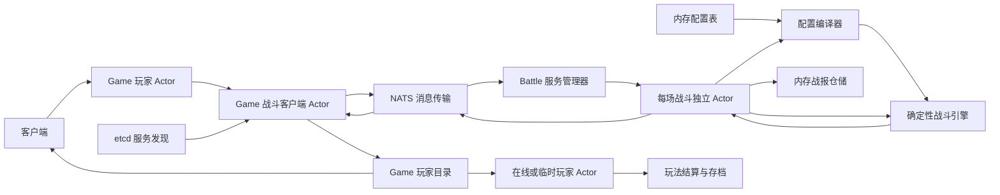
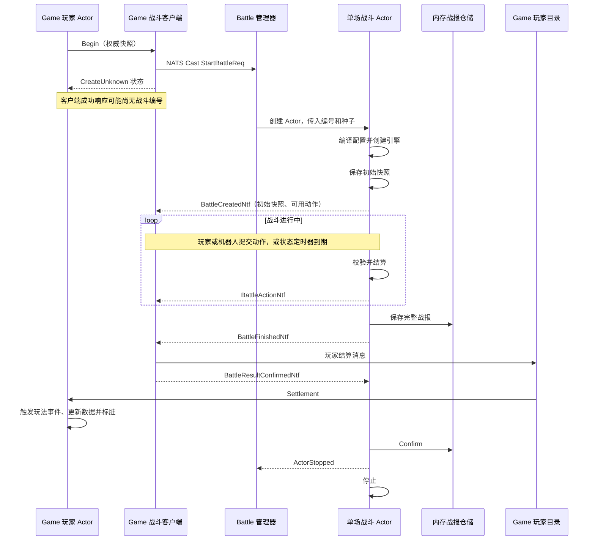

# Battle 服务架构与当前实现

更新日期：2026-11-06。依据当前工作区源码整理，包含尚未提交的代码状态；本文描述静态实现与本次测试结果，不代表线上部署状态。

## 客户端驱动的即时战斗

Game从玩家存档组装阵容。Battle 创建后立即推送初始快照，`BattleCreatedNtf.controls` 列出玩家可控制的单位、普攻和主动技能。玩家可从第零帧自行发起首击；动作被接受后，Battle 按实际出手帧和攻速校验下一次出手。

客户端按自己的节奏提交 `BattleInputReq`。每场含 AI 的即时战斗由一个通用 `RobotActor` 驱动全部防守单位，每个单位独立保存策略、请求序号和出手帧。调度器只为最早决策帧安排一次唤醒，同帧按站位和实例编号提交，通过同一个引擎入口提交动作。Battle 使用服务端经过时间校验阵营、行动间隔、冷却、技能及目标，接受后在当前帧结算并推送过程事件。客户端可指定敌方单体目标，省略目标时使用配置的选敌规则。自动攻击、主动技能、装备技能共享单位行动间隔，技能冷却沿用配置的自身行动次数。辅助技能也可显式调用。限时状态通过独立的状态到期或周期任务推进。

怪物的 `BattleMonsterCfg.AIFirstDelayTicks` 决定机器人从开战到首次提交动作的等待帧数，零表示立即出手。`BattleMonsterCfg.AISkillSequence` 指定机器人循环出招顺序；可重复填写普攻及已携带的主动技能。机器人按自己的速度和动作回执安排下次出手。动作被拒绝时尝试普攻，成功行动后推进序列。旧配置缺少序列时依次使用已有主动技能，无主动技能时普攻。

### 配置机器人施法策略

怪物表的 `AICastRules` 是按优先级排列的 `TypIDVal[]`。每项的 `ID` 必须是该怪物携带的技能，`Typ` 指定条件，`Val` 指定阈值。配置编译会拒绝未知条件、越界阈值和未携带的技能。

| Typ | 触发条件 |
| --- | --- |
| `self_hp` | 自身生命比例不高于 Val 千分比 |
| `ally_hp` | 任一存活友方（含自身）的生命比例不高于 Val 千分比 |
| `enemy_hp` | 存活敌人中生命比例最低者达到该阈值；敌方单体技能优先打该敌人，比例相同时按实例 ID 排序 |
| `enemy_count` | 存活敌人数至少为 Val |
| `always` | 技能可用即可触发，Val 填 0 |

有规则时，机器人按顺序选第一个条件满足且冷却、沉默检查通过的技能；全部未命中时普攻。无规则时仍使用原有出招序列。血量条件只控制出手时机，治疗与群攻的目标遵循技能自身目标规则。怪物 4 的示例是友方血量 ≤65% 时尝试技能 4 治疗，否则在敌人血量 ≤40% 时尝试技能 3 集火。条件策略按同批到期单位向 Battle 取一次战况快照；决策由 RobotActor 执行，提交时 Battle 仍校验最新状态。

`BattleInputAck` 返回输入序号、错误码、动作编号、当前帧及下次可出手帧。每个单位的序号从 1 开始递增，重复最近一次输入会返回缓存回执，旧序号被拒绝。装备表 `BattleEquipCfg.ActiveSkillID` 可引用一条战斗技能，穿戴后随角色进入可用动作列表；相同技能编号去重，共用冷却。

爬塔入口支持单人和多人共享战斗。已启动开发环境时可在 gogs 目录执行 `go run ./client/functest -battle -users 1` 查看单用户自动普攻流程。该工具会注册一个测试账号；加 `-battle-skill <技能编号>` 可优先尝试已携带技能，技能不可用时回退普攻。

### 多人开场与中途加入

Battle 收到创建请求后立即按初始名单开战。玩法服可以通过内部 `Begin` 请求传入同一 Game 节点上已确定的 `initial_members`。对外玩家入口只从登录角色生成本人的权威快照，忽略客户端提供的初始队友名单。

| 请求 | 行为 |
| --- | --- |
| 默认请求 | 当前角色立即开战 |
| 玩法服提供初始成员 | 全部初始成员在首个快照中同时入场 |
| `allow_join=true` | 开战后允许同层玩家增援 |
| `join_battle_id=战斗编号` | 加入进行中的战斗；已参战者可请求当前快照 |

每位成员收到全场单位血量和自己的控制信息。运行中加入时，原成员收到有序的 `UNIT_JOINED`，新成员收到含序号基线、当前帧、活动状态和自己输入序号的快照。客户端应以快照替换本地血量和状态，忽略不超过基线的旧事件。Game 检测共享战斗过程事件缺号时向 Battle 请求新快照。结算按战斗编号和 UID 去重，每名成员独立确认。测试客户端可用 `-battle -users 1 -battle-allow-join` 开战，另一进程用 `-battle -users 1 -battle-join <编号>` 加入。

## 1. 服务定位

Battle 是独立的自动战斗计算进程。Game 从玩家内存数据组装权威参战快照，Battle 将快照和配置编译为引擎输入，立即推送初始快照，按输入和状态到期事件逐次结算，终局保存战报并下发结束消息。客户端按事件时间轴播放，Game 处理玩法进度。

职责分为三层：服务管理器管理战斗 Actor 的创建和登记；每场战斗的 Actor 管理执行、推送、战报与退出；引擎负责数值、目标、技能、状态和时间轴。玩家存档和玩法奖励不属于 Battle 引擎职责。

当前已接通有限次数的结束通知重试和超时 Actor 回收，但持久战报、创建失败回传与业务结算确认仍未形成完整闭环，不能将现状描述为可恢复的可靠结算服务。

## 2. 总体结构



### 2.1 目录与职责

以下路径相对于 `gogs` 仓库根目录。

| 位置 | 职责与关键入口 |
| --- | --- |
| `battle/main.go` | 加载连接配置、日志、服务发现、数据库与配置表，启动 Actor 系统 |
| `battle/service/internal/service.go` | 服务管理器，持有 `active`、共享编译器、仓储和通知器 |
| `battle/service/internal/ctl_battle.go` | `OnCreateBattle` 生成战斗编号和随机种子；`OnActorStopped` 清理登记 |
| `battle/battle/external.go` | 对其他包公开 Actor 工厂、配置编译器及策略接口 |
| `battle/battle/internal/battle.go` | 单场即时战斗初始化、初始快照保存、事件推送、结果确认 |
| `battle/battle/internal/timer.go` | 结束通知重试、限时状态唤醒 |
| `battle/battle/internal/mode/` | 将不同玩法请求解析为角色和怪物组场景 |
| `battle/battle/internal/battleconfig/` | 读取配置、编译角色属性、技能、状态和魂玉效果 |
| `battle/battle/internal/engine/` | 纯计算核心、时间轴、随机数、事件与结果校验值 |
| `battle/battle/internal/targeting/` | 目标选择注册表及具体策略 |
| `battle/battle/internal/skilleffect/` | 效果配置定义、效果计算和应用 |
| `battle/battle/internal/battlestatus/` | 状态集合操作及持续伤害、持续治疗策略 |
| `battle/battle/internal/report.go` | 战报模型与仓储接口 |
| `battle/battle/internal/memory_repository.go` | 当前实际使用的内存战报实现 |
| `game/battle/client.go` | 节点选择、单玩家战斗状态、过程去重、结算转交与确认 |
| `game/battle/playback.go` | 根据逻辑事件时间维护下一场战斗准入窗口 |
| `game/play/internal/ctl/ctl_battle/battle.go` | 从玩家状态组装请求、响应客户端、触发玩家结算事件 |
| `game/play/internal/ctl/ctl_tower/tower.go` | 爬塔胜利结算与玩家层数更新 |
| `natsrpc/` | 进程间发布和 Actor 名称寻址 |

依赖方向为 `service → battle → battleconfig/engine`；引擎通过接口使用可替换策略，不反向依赖服务管理器，也不在模拟期间查询配置数据库。

## 3. 启动、寻址与并发模型

`battle/main.go` 的启动顺序是加载连接参数、初始化日志、通过 `cluster.Init` 初始化 etcd 客户端，再通过 `cluster.StartService` 启动区服时间偏移监听并注册 Battle 节点。随后连接 MongoDB、加载配置表、创建 Mongo Actor、Battle 服务管理器和 NATS Actor，最后启动 Actor 系统。

- 时间偏移来自 `--server-id` 对应的 `/time/{serverID}`，服务退出时关闭监听。etcd 初始化、初始时间偏移读取或配置表加载失败会返回错误。Battle 节点使用 `/services/Battle/{serverID}/{nodeID}`，与 Game 共用租约续租和重试逻辑。首次注册失败时记录日志并在后台重试。
- `BattleAddr()` 是注册到服务发现的地址。当前战斗消息通过 NATS 传输，入口没有另行启动该地址的战斗 HTTP 或 TCP 监听。
- Game 的 `ClusterSelector.Pick` 从发现结果中轮询节点，没有按活跃战斗数进行负载分配。
- 管理器注册名为 `BATTLE_SERVICE`；单场 Actor 名为 `BATTLE_ACTOR_<战斗编号>`；Game 接收端为 `BATTLE_CLIENT`。
- 管理器邮箱容量为 1024，单场战斗为 256，Game 战斗客户端及 NATS Actor 为 8192。不同战斗由不同 Actor 执行；单场状态在所属 Actor 消息处理中串行推进。
- `OnInit` 只初始化并投递内部启动消息；单场初始化和动作结算在邮箱循环中执行，避免 `SpawnOne` 等待计算与网络下发，阻塞管理器创建其他战斗。
- 编译器和仓储由管理器共享。编译器每场生成独立的引擎输入；内存仓储用读写锁保护战报映射。
- NATS 是共享传输通道。`Cast` 最多等待 5 秒确认本地编码、发布操作完成，不等待远端业务执行成功；逐条事件推送仍会占用战斗 Actor 的处理时间。

依据：`battle/main.go`、`battle/service/internal/service.go`、`battle/battle/internal/battle.go`、`game/battle/client.go`、`natsrpc/external.go`、`natsrpc/internal/nats.go`、`def/constant.go`。

## 4. 一场战斗的完整链路



图中确认与玩家结算之间没有完成等待关系：Game 战斗客户端发出确认时，玩家 Actor 可能尚未处理结算。

### 4.1 Game 组装请求

`buildBattleRequest` 从当前玩家的角色、装备、魂玉、天赋加成和爬塔层数生成请求，覆盖客户端提供的参战数据。当前入口固定使用爬塔类型，怪物组编号取当前层数，业务编号为 `tower-玩家编号-层数`。

角色快照包含角色配置与实例编号、等级、星级、突破、技能、装备、魂玉效果词条和成长加成。Game 战斗客户端再次克隆请求，并写入实际来源服务器与节点。

`BusinessId` 当前没有参与 Battle 管理器去重，也未写入最终结果模型。防止重复开战主要依赖 Game 进程内的玩家状态，Battle 管理器本身不按玩家或业务编号做幂等检查。

### 4.2 即时输入与过程下发

收到创建通知后客户端可发起首击。Game 根据玩家当前战斗编号和所属节点转发输入。Battle Actor 处理到期状态后校验动作，在当前帧结算并推送事件，回执给出下次可出手帧。每场共用的机器人 Actor 独立调度各个防守单位。

### 4.4 收尾与玩法结算

引擎完成后，Actor 保存包含初始快照、全部事件和最终结果的战报，再下发终局事件和结束通知。这里的“保存”当前只是写内存仓储，不能理解为已写入 MongoDB。

Game 用战斗编号和收件人 UID 在 `completed` 中去重结束通知，推送客户端，并将 `Settlement` 交给 `GameGate` 玩家目录。在线玩家交给现有 Actor；离线玩家可创建临时 Actor 加载和处理系统消息。每名参战者由其所属 Game 节点分别投递结算。

玩家入口触发 `BattleSettled` 事件；爬塔监听器校验玩法、胜负和参与者后，将当前层数加一并标记玩家数据脏。Battle 不直接修改玩家存档，当前该监听器也没有奖励发放逻辑。

## 5. 配置编译与扩展点

编译过程为 `StartBattleReq → mode.Rule.Resolve → 场景与配置解析 → engine.Setup → engine.NewBattle`。

| 配置或策略 | 当前作用 |
| --- | --- |
| `BattleRuleCfg` | 行动阈值、最大行动数、逻辑帧时长、伤害浮动与暴击参数 |
| `BattleRoleCfg`、`BattleEquipCfg` | 角色基础属性、站位、默认技能与装备加值 |
| `BattleMonsterGroupCfg`、`BattleMonsterCfg` | 怪物组合、站位、属性及技能 |
| `BattleSkillCfg`、`BattleStatusCfg` | 技能目标、冷却、前后摇、效果与状态配置 |
| `SoulJadeEffectAffixCfg` | 将魂玉效果词条编译为角色被动积攒效果 |
| `RoleStatCalculator` | 可替换的角色属性计算 |
| `RoleSkillProgression` | 可替换的技能成长处理，默认实现直接返回原技能 |
| `Strategies` | 目标选择、技能执行、效果解析、伤害公式和状态处理接口 |

默认属性计算顺序是“角色基础值 + 装备固定加值”，再乘以 `(1000 + 成长千分比) / 1000`。协议携带等级、星级、突破和精炼信息，不代表默认计算器已经使用这些字段实现完整成长曲线。

玩法规则支持爬塔、首领、剧情、测试和玩家对战。前四种要求进攻角色与怪物组，禁止传防守角色；玩家对战要求双方各一个角色且不带怪物组。服务能力与当前固定爬塔的玩家入口需要区分。

新增功能的优先落点：玩法解析放 `mode`；配置到运行时数据转换放 `battleconfig`；选敌放 `targeting`；技能效果放 `skilleffect`；周期状态放 `battlestatus`；奖励和进度放 Game 玩家业务模块。避免将具体玩法分支扩散到时间轴核心。

## 6. 引擎与确定性

### 6.1 时间轴

行动间隔为 `max(1, ceil(ATBThreshold / Speed))`，首击由控制端决定。被接受的普攻、辅助技能及其他主动技能在同一逻辑帧结算。战斗 Actor 的时间轮唤醒限时状态，机器人 Actor 的时间轮驱动 AI 决策。达到最大行动数或一方全灭时生成结果。

### 6.2 技能、伤害与积攒效果

默认目标策略包括自身、敌方单体、敌方全体和生命值最低的友方。效果包括伤害、治疗、施加状态、冰爆和雷击。

默认伤害按攻防差、技能千分比系数和固定值、随机浮动、暴击依次计算，最终至少为 1；实际扣血不超过目标剩余生命值。

冰爆和雷击的积攒状态保存在每个运行时角色的 `charges` 中，不按阵营共享。原技能对一个目标实际造成正数伤害才记一次有效命中，原技能所有目标结算后再处理积攒与触发。同一角色的技能同类积攒共享阈值；技能显式配置的同类效果优先于魂玉被动配置。

### 6.3 限时状态与周期效果

状态同时支持原有行动回合计时和新增逻辑时间计时，两种方式互斥。配置源为 `../glconf/BattleStatusCfg.tsv`，编译入口为 `battleconfig`，状态生命周期由 `engine/status.go` 与 `battlestatus` 配合处理。

| 场景 | DurationTurns | DurationMS | IntervalMS |
| --- | --- | --- | --- |
| 持续两次自身行动 | 2 | 0 | 0 |
| 持续三秒的属性或控制效果 | 0 | 3000 | 0 |
| 持续三秒、每秒伤害或治疗 | 0 | 3000 | 1000 |

持续时间和周期间隔分别向上取整为逻辑帧，不等待现实时间，不创建系统定时器。到期帧等于施加帧加持续帧数。同帧先到期、再周期效果、再命中及动作处理；三秒持续、每秒触发的效果在第一、第二秒结算，第三秒只移除。时间不能整除帧长时，每次周期按向上取整后的间隔安排。

同目标、同来源、同配置编号的限时状态再次施加时刷新持续时间和周期起点，复用实例编号并增加版本；旧任务因版本不匹配失效。不同来源独立存在。回合状态保留原有独立叠加规则，行动开始触发周期效果，行动结束扣回合。

初始状态在第零帧产生施加事件。协议增加状态实例编号、到期帧、版本，以及状态移除事件；客户端需按逻辑时间和实例编号更新图标与特效，刷新不能重复创建图标。周期伤害、治疗记录施加者来源。死亡单位不再触发周期效果，整场结束后不等待剩余状态到期，客户端结束演出时清理状态。

当前只在后续行动间隔计算时读取状态修正后的速度，不重排已经入队的动作；本次未增加通用被动触发或驱散技能，内部移除入口已支持提前移除后的旧任务失效。配置仅生成代码，没有导入线上数据库；正式使用新配置需按正常发布流程导入，客户端也需要同步协议并接入事件。

### 6.4 重现与校验的边界

随机数采用明确的 `uint64` SplitMix64，配合稳定时间轴排序，使相同引擎输入、种子和策略能够重现结果。结果校验值是战斗编号、类型、胜负、结束逻辑帧、帧时长、单位结果和完整事件序列的 JSON 编码 SHA-256，因此不同战斗编号也会影响校验值。

目前 `Report` 保存结果和事件，没有保存完整 `Setup`、随机种子或配置版本。`ModeRedeliver` 是重发已有事件，不是根据原始输入重新计算；该模式已有 Actor 内部分支，但管理器没有公开的战报查询或重投路由。

## 7. 状态、存储与可靠性边界

Game 单玩家状态流转为 `Idle → Creating → CreateUnknown → Running → Finished`。本地发布失败回到 `Idle`；收到创建通知进入 `Running`；结束通知可以补偿创建通知缺失，直接进入 `Finished`。`Creating`、`CreateUnknown`、`Running` 阶段禁止再次创建或执行普通重置；`Finished` 阶段还需要等待服务端演出准入窗口结束。

过程事件以 `Sequence` 做内存去重，并记录最大序号；当前没有缺号补拉、连续性验证或客户端送达确认。结束通知的校验值被保存，但 Game 没有重算整场事件校验值。

| 项目 | 当前源码事实 | 对架构能力的影响 |
| --- | --- | --- |
| 战报存储 | 管理器装配 `NewMemoryRepository`；启动的 Mongo Actor 未接入该仓储 | 重启丢失战报，不能据此承诺持久恢复 |
| 结束通知重试 | 时间轮按管理器配置的 1 秒间隔重发，最多投递 3 次，耗尽后回收 Actor | 仅重试结束消息，不补齐过程事件；未确认战报仍留在内存 |
| 结算确认 | Game 写入 `completed` 并投递玩家消息后直接确认，投递失败也仍确认 | 确认不代表玩法已处理或存档成功，存在结算丢失窗口 |
| 创建失败 | 配置编译或引擎构建失败后 Actor 记录日志并退出 | Game 可能停留在 `CreateUnknown`，没有自动超时恢复闭环 |
| 过程推送失败 | 记录日志后继续模拟，没有逐条重发 | 客户端可能缺少演出事件 |
| 幂等范围 | Game 玩家状态和结束去重均为内存数据；爬塔监听器直接加当前层数 | 没有跨重启的业务幂等凭据；不能视为严格的一次结算 |
| 数据保留 | 内存战报和 Game 的 `completed` 无淘汰逻辑 | 长期运行需要补充容量与保留策略 |
| 关服回收 | 管理器 `OnStop` 为空，未实现战报恢复或未确认结果排空流程 | 不能承诺关服期间完成所有在途战斗 |
| 运维参数 | `battle-config`、重试次数与延迟参数有 CLI 声明，但当前管理器仍固定使用默认编译器、1 秒和 3 次 | 修改这些 CLI 参数不会改变当前装配值 |

仓储接口保留持久化抽象，但当前装配仍是内存写入；消息发布仅等待本地发布结果，不代表对端业务成功。

除即时输入、初始快照、结果重试和准入窗口外，上表其余可靠性缺口仍需后续处理。

## 8. 维护与排查入口

| 现象 | 建议按顺序检查 |
| --- | --- |
| 无法创建 | Game 开服状态、权威角色组装、etcd 节点、NATS 发布、管理器包络校验、Actor 配置编译日志 |
| 卡在创建中 | `GetState` 是否为 `CreateUnknown`、创建通知是否产生、是否有编译失败或 NATS 路由失败 |
| 演出断续 | 客户端是否缓存并按逻辑时间播放、事件序号、NATS 队列和推送耗时、动作窗口 |
| 伤害不符合预期 | 角色与装备配置、成长加成、技能效果、伤害浮动及暴击、状态修正 |
| 结束后未更新层数 | Game 结束去重、玩家目录是否收到消息、参与者和玩法类型、`BattleSettled` 监听器、玩家标脏与存盘 |
| Actor 或内存持续增长 | 结果重试是否结束、发布阻塞、内存战报和完成记录的累计量 |

核心日志标识包括 `[战斗/创建]`、`[战斗/执行]`、`[战斗/过程]`、`[战斗/结算]`、`[战斗/回收]`、`[battle/Client.finished]` 与 `[ctl_tower/OnTowerBattleResults]`。定位同一场战斗时使用战斗编号关联两端日志。

优先完善顺序建议为：先补创建失败和超时状态恢复，再把业务处理确认与持久幂等衔接起来，随后接入持久战报、恢复重投和清理策略，最后完善多玩法入口与负载调度。这是后续建议，不是当前已有能力。

## 9. 本次验证

执行命令：

```sh
GOCACHE=/tmp/gogs-battle-doc-gocache go test ./battle/... ./game/battle/...
```

- `./battle/...` 全部通过，包括引擎确定性、增量推进与一次执行一致性、动作重叠与取消、成长编译、魂玉和冰雷积攒测试。
- `TestBattleStreamsBeforeFinalReport` 验证先发送初始快照、按序推送事件，并在结束通知前保存战报。
- `./game/battle` 全部通过。测试已补充开服前置事件，并验证提前收到结果后不能通过创建或重置绕过演出窗口，以及窗口到期后解除时间限制。
- `TestComputedReportRetriesAndRetires` 验证结束通知次数、重试结果一致性与超时回收；`TestSlowDeliveryDoesNotBlockManager` 验证慢投递期间仍可创建另一场战斗。
- 未启动真实 Game/Battle/NATS/etcd/Mongo 环境做端到端验证，未验证真实客户端演出、故障恢复或玩家存盘成功。

协议源位于相邻仓库 `../protocol/cspb/battle/`，错误码位于 `../protocol/cspb/common/error.proto`；`pb/cspb/pb_battle/` 是生成结果。扩展协议时应修改源文件并走现有生成流程。

### 9.1 改动范围与规范例外

本次保留既有 Actor 内部状态和引擎数据模型的直接字段访问方式，涉及 `battle/battle/internal/battle.go`、`timer.go`、`report.go` 和 `game/battle/client.go`、`playback.go`，属于代码规范第 1、4、7 条关于短变量、Getter 与嵌套访问的局部例外。原因是这些状态由所属 Actor 串行维护，批量生成访问方法会扩大本次执行模式和包重命名的改动范围；未据此改变公开协议或现有接口。配置组装层已有的属性访问方法已按新目录重新生成。

限时状态扩展沿用引擎与配置组装层的直接字段访问，属于同样的局部例外；配置校验及状态策略继续返回既有 `error` 接口，而不改成业务错误码，属于第 10 条的兼容例外。引擎内部状态变更通过确定性战斗事件记录，不逐帧输出日志，属于第 14 条的例外，避免产生大量逐帧日志；Actor 外层保留错误日志。
