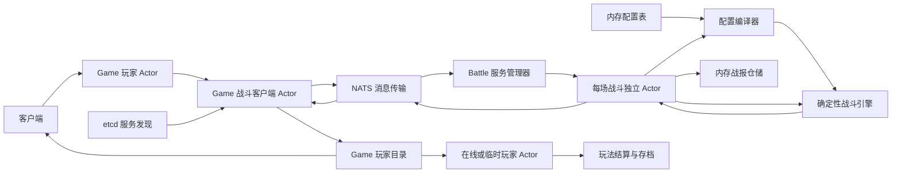
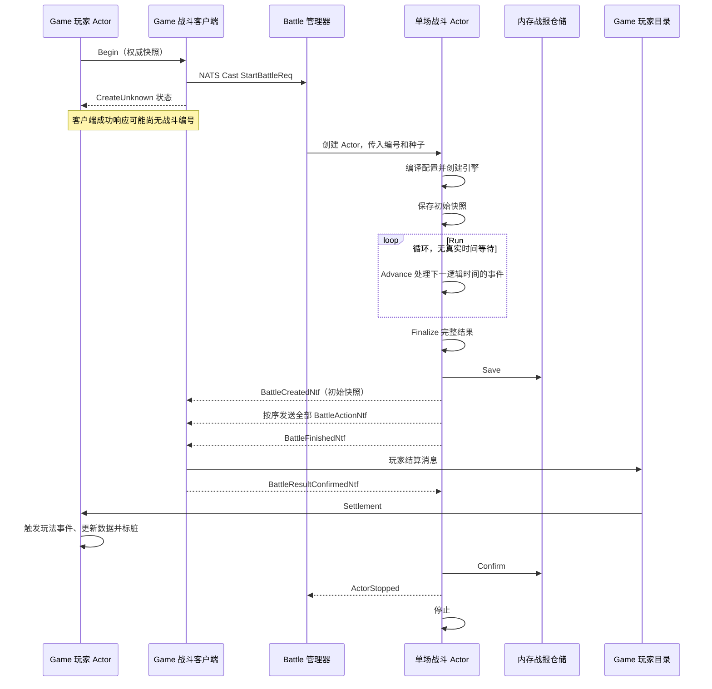

# Battle 服务架构与当前实现

更新日期：2026-11-06。依据当前工作区源码整理，包含尚未提交的代码状态；本文描述静态实现与本次测试结果，不代表线上部署状态。

## 1. 服务定位

Battle 是独立的自动战斗计算进程。Game 从玩家内存数据组装权威参战快照，Battle 将快照和配置编译为引擎输入，通过 `Run()` 循环推进逻辑时间，快速算完整场并保存战报，再依次下发创建、过程和结束消息。客户端按事件时间轴播放，Game 处理玩法进度。

职责分为三层：服务管理器管理战斗 Actor 的创建和登记；每场战斗的 Actor 管理执行、推送、战报与退出；引擎负责数值、目标、技能、状态和时间轴。玩家存档和玩法奖励不属于 Battle 引擎职责。

当前已接通有限次数的结束通知重试和超时 Actor 回收，但持久战报、创建失败回传与业务结算确认仍未形成完整闭环，不能将现状描述为可恢复的可靠结算服务。

## 2. 总体结构



### 2.1 目录与职责

以下路径相对于 `gogs` 仓库根目录。

| 位置 | 职责与关键入口 |
| --- | --- |
| `battle/main.go` | 加载连接配置、日志、服务发现、数据库与配置表，启动 Actor 系统 |
| `battle/service/internal/service.go` | 服务管理器，持有 `active`、共享编译器、仓储和通知器 |
| `battle/service/internal/ctl_battle.go` | `OnCreateBattle` 生成战斗编号和随机种子；`OnActorStopped` 清理登记 |
| `battle/battle/external.go` | 对其他包公开 Actor 工厂、配置编译器及策略接口 |
| `battle/battle/internal/battle.go` | 单场战斗完整计算、初始快照保存、事件推送、结果确认 |
| `battle/battle/internal/timer.go` | 结束通知重试，不参与计算时间推进 |
| `battle/battle/internal/mode/` | 将不同玩法请求解析为角色和怪物组场景 |
| `battle/battle/internal/battleconfig/` | 读取配置、编译角色属性、技能、状态和魂玉效果 |
| `battle/battle/internal/engine/` | 纯计算核心、时间轴、随机数、事件与结果校验值 |
| `battle/battle/internal/targeting/` | 目标选择注册表及具体策略 |
| `battle/battle/internal/skilleffect/` | 效果配置定义、效果计算和应用 |
| `battle/battle/internal/battlestatus/` | 状态集合操作及持续伤害、持续治疗策略 |
| `battle/battle/internal/report.go` | 战报模型与仓储接口 |
| `battle/battle/internal/memory_repository.go` | 当前实际使用的内存战报实现 |
| `game/battle/client.go` | 节点选择、单玩家战斗状态、过程去重、结算转交与确认 |
| `game/battle/playback.go` | 根据逻辑事件时间维护下一场战斗准入窗口 |
| `game/play/internal/ctl/ctl_battle/battle.go` | 从玩家状态组装请求、响应客户端、触发玩家结算事件 |
| `game/play/internal/ctl/ctl_tower/tower.go` | 爬塔胜利结算与玩家层数更新 |
| `natsrpc/` | 进程间发布和 Actor 名称寻址 |

依赖方向为 `service → battle → battleconfig/engine`；引擎通过接口使用可替换策略，不反向依赖服务管理器，也不在模拟期间查询配置数据库。

## 3. 启动、寻址与并发模型

`battle/main.go` 的启动顺序是加载连接参数、初始化日志、初始化并注册 etcd 服务、连接 MongoDB、加载配置表，再创建 Mongo Actor、Battle 服务管理器和 NATS Actor，最后启动 Actor 系统。

- etcd 服务类型为 `Battle`，以服务器编号和节点编号标识实例。初始化或注册失败只记录日志；配置表加载失败则返回错误。
- `BattleAddr()` 是注册到服务发现的地址。当前战斗消息通过 NATS 传输，入口没有另行启动该地址的战斗 HTTP 或 TCP 监听。
- Game 的 `ClusterSelector.Pick` 从发现结果中轮询节点，没有按活跃战斗数进行负载分配。
- 管理器注册名为 `BATTLE_SERVICE`；单场 Actor 名为 `BATTLE_ACTOR_<战斗编号>`；Game 接收端为 `BATTLE_CLIENT`。
- 管理器邮箱容量为 1024，单场战斗为 256，Game 战斗客户端及 NATS Actor 为 8192。不同战斗由不同 Actor 执行；单场状态在所属 Actor 消息处理中串行推进。
- `OnInit` 只初始化并投递内部启动消息；整场计算在初始化返回后的邮箱循环中执行，避免 `SpawnOne` 等待计算与网络下发，阻塞管理器创建其他战斗。
- 编译器和仓储由管理器共享。编译器每场生成独立的引擎输入；内存仓储用读写锁保护战报映射。
- NATS 是共享传输通道。`Cast` 最多等待 5 秒确认本地编码、发布操作完成，不等待远端业务执行成功；逐条事件推送仍会占用战斗 Actor 的处理时间。

依据：`battle/main.go`、`battle/service/internal/service.go`、`battle/battle/internal/battle.go`、`game/battle/client.go`、`natsrpc/external.go`、`natsrpc/internal/nats.go`、`def/constant.go`。

## 4. 一场战斗的完整链路



图中确认与玩家结算之间没有完成等待关系：Game 战斗客户端发出确认时，玩家 Actor 可能尚未处理结算。

### 4.1 Game 组装请求

`buildBattleRequest` 从当前玩家的角色、装备、魂玉、天赋加成和爬塔层数生成请求，覆盖客户端提供的参战数据。当前入口固定使用爬塔类型，怪物组编号取当前层数，业务编号为 `tower-玩家编号-层数`。

角色快照包含角色配置与实例编号、等级、星级、突破、技能、装备、魂玉效果词条和成长加成。Game 战斗客户端再次克隆请求，并写入实际来源服务器与节点。

`BusinessId` 当前没有参与 Battle 管理器去重，也未写入最终结果模型。防止重复开战主要依赖 Game 进程内的玩家状态，Battle 管理器本身不按玩家或业务编号做幂等检查。

### 4.2 完整计算与过程下发

管理器校验玩家、来源服务器、来源节点及非零战斗类型，生成 UUID 和加密随机种子，再创建 Actor。具体玩法、配置和单位合法性由 Actor 中的编译器及引擎进一步校验。

服务管理器虽然调用 `ctx.Response(StartBattleAck)`，正常 Game 创建链路使用的是 `Cast`，没有等待这个远端响应。客户端收到的创建响应来自 Game 本地 `Begin` 的状态回调；真正的创建完成由 `BattleCreatedNtf` 驱动。

Actor 编译成功后先保存 `UnitResults()` 的初始快照，再执行 `Run()`。循环中的 `Advance` 直接跳到下一个存在事件的逻辑帧，处理该帧所有动作阶段，不使用真实时间定时器，也不等待动画。速度、前摇、后摇、目标快照、命中取消等计算规则保持不变。

计算与战报保存成功后，先发送包含初始快照的创建通知，再按序发送全部事件，最后发送结束通知。为兼容现有消息路由，暂时保持单事件消息格式，没有新增批量协议。完成投递后释放引擎引用，Actor 仅等待结束通知确认或重试耗尽。

默认逻辑帧时长为 100 毫秒，配置可覆盖；帧时长影响客户端播放时刻，不影响计算等待时间。原来的 `PaceTickDuration` 和战斗节拍定时器已移除，真实时间定时器只用于结果投递重试。

### 4.3 客户端播放约定

客户端需要先缓存事件并建立统一播放时钟，不能把消息到达时刻当成动作发生时刻：

```text
播放时刻 = 播放锚点 + (事件 tick - 首个事件 tick) × TickDurationMS
前摇时长 = (impact_tick - start_tick) × TickDurationMS
后摇时长 = (end_tick - impact_tick) × TickDurationMS
```

首个事件作为播放零点，保持首个动作立即开始的表现。技能事件提供动作窗口，伤害和状态按各自事件时间应用；结束通知提前收到时先缓存，播放完整时间轴后再展示结算。不同角色动作允许重叠，同一行动通过 `action` 编号关联。

Game 仍会在收到结果时执行业务结算，但 `playbackWindow` 根据首次收到事件的时间和完整逻辑跨度限制下一场准入；演出窗口未结束时，创建和重置均返回 `ErrInProgress`。该限制由服务端维护，不信任客户端“播放完成”上报，也不会占用等待协程。当前没有提供跳过演出、倍速缩短准入或跨重启恢复窗口的接口。

本次仓库修改不包含图形客户端播放代码。旧客户端若收到结束通知就立即退出战斗，必须按上述约定调整后才能正确演出。

### 4.4 收尾与玩法结算

引擎完成后，Actor 保存包含初始快照、全部事件和最终结果的战报，再下发全部消息。这里的“保存”当前只是写内存仓储，不能理解为已写入 MongoDB。

Game 用战斗编号在 `completed` 中去重结束通知，推送客户端，并将 `Settlement` 交给 `GameGate` 玩家目录。在线玩家交给现有 Actor；离线玩家可创建临时 Actor 加载和处理系统消息。当前结算参战列表仅包含发起玩家。

玩家入口触发 `BattleSettled` 事件；爬塔监听器校验玩法、胜负和参与者后，将当前层数加一并标记玩家数据脏。Battle 不直接修改玩家存档，当前该监听器也没有奖励发放逻辑。

## 5. 配置编译与扩展点

编译过程为 `StartBattleReq → mode.Rule.Resolve → 场景与配置解析 → engine.Setup → engine.NewBattle`。

| 配置或策略 | 当前作用 |
| --- | --- |
| `BattleRuleCfg` | 行动阈值、最大行动数、逻辑帧时长、伤害浮动与暴击参数 |
| `BattleRoleCfg`、`BattleEquipCfg` | 角色基础属性、站位、默认技能与装备加值 |
| `BattleMonsterGroupCfg`、`BattleMonsterCfg` | 怪物组合、站位、属性及技能 |
| `BattleSkillCfg`、`BattleStatusCfg` | 技能目标、冷却、前后摇、效果与状态配置 |
| `SoulJadeEffectAffixCfg` | 将魂玉效果词条编译为角色被动积攒效果 |
| `RoleStatCalculator` | 可替换的角色属性计算 |
| `RoleSkillProgression` | 可替换的技能成长处理，默认实现直接返回原技能 |
| `Strategies` | 目标选择、技能执行、效果解析、伤害公式和状态处理接口 |

默认属性计算顺序是“角色基础值 + 装备固定加值”，再乘以 `(1000 + 成长千分比) / 1000`。协议携带等级、星级、突破和精炼信息，不代表默认计算器已经使用这些字段实现完整成长曲线。

玩法规则支持爬塔、首领、剧情、测试和玩家对战。前四种要求进攻角色与怪物组，禁止传防守角色；玩家对战要求双方各一个角色且不带怪物组。服务能力与当前固定爬塔的玩家入口需要区分。

新增功能的优先落点：玩法解析放 `mode`；配置到运行时数据转换放 `battleconfig`；选敌放 `targeting`；技能效果放 `skilleffect`；周期状态放 `battlestatus`；奖励和进度放 Game 玩家业务模块。避免将具体玩法分支扩散到时间轴核心。

## 6. 引擎与确定性

### 6.1 时间轴

引擎使用最小堆调度行动，排序键依次为逻辑帧、阶段、行动编号、单位站位和实例编号。同一逻辑帧优先处理已有动作的命中，再处理动作结束，最后允许新动作开始。

行动间隔为 `max(1, ceil(ATBThreshold / Speed))`。一次动作有开始、命中、结束三个时间点，多个单位动作可重叠。速度提高时可等比压缩前后摇，并保留至少一个逻辑帧的前摇和后摇。

技能使用事件直接携带三个时间点和目标列表，客户端可立即安排演出。目标在动作开始时确定；命中时如果出手者或目标已死亡，会产生取消事件，不自动重新选敌。

状态和冷却随单位行动处理：行动开始时推进冷却与周期效果，行动结束时递减状态持续回合。眩晕、沉默、属性修正由引擎及状态集合处理，持续伤害和治疗通过各自策略实现。

终止条件包括一方无存活单位以及达到最大行动数；已开始的动作仍需完成对应处理。`Run` 是反复 `Advance` 后 `Finalize` 的快捷入口，`Finalize` 重复调用返回缓存结果。

### 6.2 技能、伤害与积攒效果

默认目标策略包括自身、敌方单体、敌方全体和生命值最低的友方。效果包括伤害、治疗、施加状态、冰爆和雷击。

默认伤害按攻防差、技能千分比系数和固定值、随机浮动、暴击依次计算，最终至少为 1；实际扣血不超过目标剩余生命值。

冰爆和雷击的积攒状态保存在每个运行时角色的 `charges` 中，不按阵营共享。原技能对一个目标实际造成正数伤害才记一次有效命中，原技能所有目标结算后再处理积攒与触发。同一角色的技能同类积攒共享阈值；技能显式配置的同类效果优先于魂玉被动配置。

### 6.3 限时状态与周期效果

状态同时支持原有行动回合计时和新增逻辑时间计时，两种方式互斥。配置源为 `../glconf/BattleStatusCfg.tsv`，编译入口为 `battleconfig`，状态生命周期由 `engine/status.go` 与 `battlestatus` 配合处理。

| 场景 | DurationTurns | DurationMS | IntervalMS |
| --- | --- | --- | --- |
| 持续两次自身行动 | 2 | 0 | 0 |
| 持续三秒的属性或控制效果 | 0 | 3000 | 0 |
| 持续三秒、每秒伤害或治疗 | 0 | 3000 | 1000 |

持续时间和周期间隔分别向上取整为逻辑帧，不等待现实时间，不创建系统定时器。到期帧等于施加帧加持续帧数。同帧先到期、再周期效果、再命中及动作处理；三秒持续、每秒触发的效果在第一、第二秒结算，第三秒只移除。时间不能整除帧长时，每次周期按向上取整后的间隔安排。

同目标、同来源、同配置编号的限时状态再次施加时刷新持续时间和周期起点，复用实例编号并增加版本；旧任务因版本不匹配失效。不同来源独立存在。回合状态保留原有独立叠加规则，行动开始触发周期效果，行动结束扣回合。

初始状态在第零帧产生施加事件。协议增加状态实例编号、到期帧、版本，以及状态移除事件；客户端需按逻辑时间和实例编号更新图标与特效，刷新不能重复创建图标。周期伤害、治疗记录施加者来源。死亡单位不再触发周期效果，整场结束后不等待剩余状态到期，客户端结束演出时清理状态。

当前只在后续行动间隔计算时读取状态修正后的速度，不重排已经入队的动作；本次未增加通用被动触发或驱散技能，内部移除入口已支持提前移除后的旧任务失效。配置仅生成代码，没有导入线上数据库；正式使用新配置需按正常发布流程导入，客户端也需要同步协议并接入事件。

### 6.4 重现与校验的边界

随机数采用明确的 `uint64` SplitMix64，配合稳定时间轴排序，使相同引擎输入、种子和策略能够重现结果。结果校验值是战斗编号、类型、胜负、结束逻辑帧、帧时长、单位结果和完整事件序列的 JSON 编码 SHA-256，因此不同战斗编号也会影响校验值。

目前 `Report` 保存结果和事件，没有保存完整 `Setup`、随机种子或配置版本。`ModeRedeliver` 是重发已有事件，不是根据原始输入重新计算；该模式已有 Actor 内部分支，但管理器没有公开的战报查询或重投路由。

## 7. 状态、存储与可靠性边界

Game 单玩家状态流转为 `Idle → Creating → CreateUnknown → Running → Finished`。本地发布失败回到 `Idle`；收到创建通知进入 `Running`；结束通知可以补偿创建通知缺失，直接进入 `Finished`。`Creating`、`CreateUnknown`、`Running` 阶段禁止再次创建或执行普通重置；`Finished` 阶段还需要等待服务端演出准入窗口结束。

过程事件以 `Sequence` 做内存去重，并记录最大序号；当前没有缺号补拉、连续性验证或客户端送达确认。结束通知的校验值被保存，但 Game 没有重算整场事件校验值。

| 项目 | 当前源码事实 | 对架构能力的影响 |
| --- | --- | --- |
| 战报存储 | 管理器装配 `NewMemoryRepository`；启动的 Mongo Actor 未接入该仓储 | 重启丢失战报，不能据此承诺持久恢复 |
| 结束通知重试 | 时间轮按管理器配置的 1 秒间隔重发，最多投递 3 次，耗尽后回收 Actor | 仅重试结束消息，不补齐过程事件；未确认战报仍留在内存 |
| 结算确认 | Game 写入 `completed` 并投递玩家消息后直接确认，投递失败也仍确认 | 确认不代表玩法已处理或存档成功，存在结算丢失窗口 |
| 创建失败 | 配置编译或引擎构建失败后 Actor 记录日志并退出 | Game 可能停留在 `CreateUnknown`，没有自动超时恢复闭环 |
| 过程推送失败 | 记录日志后继续模拟，没有逐条重发 | 客户端可能缺少演出事件 |
| 幂等范围 | Game 玩家状态和结束去重均为内存数据；爬塔监听器直接加当前层数 | 没有跨重启的业务幂等凭据；不能视为严格的一次结算 |
| 数据保留 | 内存战报和 Game 的 `completed` 无淘汰逻辑 | 长期运行需要补充容量与保留策略 |
| 关服回收 | 管理器 `OnStop` 为空，未实现战报恢复或未确认结果排空流程 | 不能承诺关服期间完成所有在途战斗 |
| 运维参数 | `battle-config`、重试次数与延迟参数有 CLI 声明，但当前管理器仍固定使用默认编译器、1 秒和 3 次 | 修改这些 CLI 参数不会改变当前装配值 |

仓储接口保留持久化抽象，但当前装配仍是内存写入；消息发布仅等待本地发布结果，不代表对端业务成功。

除完整预计算、初始快照、结果重试和准入窗口外，上表其余可靠性缺口仍需后续处理。

## 8. 维护与排查入口

| 现象 | 建议按顺序检查 |
| --- | --- |
| 无法创建 | Game 开服状态、权威角色组装、etcd 节点、NATS 发布、管理器包络校验、Actor 配置编译日志 |
| 卡在创建中 | `GetState` 是否为 `CreateUnknown`、创建通知是否产生、是否有编译失败或 NATS 路由失败 |
| 演出断续 | 客户端是否缓存并按逻辑时间播放、事件序号、NATS 队列和推送耗时、动作窗口 |
| 伤害不符合预期 | 角色与装备配置、成长加成、技能效果、伤害浮动及暴击、状态修正 |
| 结束后未更新层数 | Game 结束去重、玩家目录是否收到消息、参与者和玩法类型、`BattleSettled` 监听器、玩家标脏与存盘 |
| Actor 或内存持续增长 | 结果重试是否结束、发布阻塞、内存战报和完成记录的累计量 |

核心日志标识包括 `[战斗/创建]`、`[战斗/执行]`、`[战斗/过程]`、`[战斗/结算]`、`[战斗/回收]`、`[battle/Client.finished]` 与 `[ctl_tower/OnTowerBattleResults]`。定位同一场战斗时使用战斗编号关联两端日志。

优先完善顺序建议为：先补创建失败和超时状态恢复，再把业务处理确认与持久幂等衔接起来，随后接入持久战报、恢复重投和清理策略，最后完善多玩法入口与负载调度。这是后续建议，不是当前已有能力。

## 9. 本次验证

执行命令：

```sh
GOCACHE=/tmp/gogs-battle-doc-gocache go test ./battle/... ./game/battle/...
```

- `./battle/...` 全部通过，包括引擎确定性、增量推进与一次执行一致性、动作重叠与取消、成长编译、魂玉和冰雷积攒测试。
- `TestBattleComputesBeforeDelivery` 将每帧设为一分钟，验证仍在两秒内完成投递，并校验先保存战报、初始满血快照、事件时间及序号顺序。
- `./game/battle` 全部通过。测试已补充开服前置事件，并验证提前收到结果后不能通过创建或重置绕过演出窗口，以及窗口到期后解除时间限制。
- `TestComputedReportRetriesAndRetires` 验证结束通知次数、重试结果一致性与超时回收；`TestSlowDeliveryDoesNotBlockManager` 验证慢投递期间仍可创建另一场战斗。
- 未启动真实 Game/Battle/NATS/etcd/Mongo 环境做端到端验证，未验证真实客户端演出、故障恢复或玩家存盘成功。

协议源位于相邻仓库 `../protocol/cspb/battle/`，错误码位于 `../protocol/cspb/common/error.proto`；`pb/cspb/pb_battle/` 是生成结果。扩展协议时应修改源文件并走现有生成流程。

### 9.1 改动范围与规范例外

本次保留既有 Actor 内部状态和引擎数据模型的直接字段访问方式，涉及 `battle/battle/internal/battle.go`、`timer.go`、`report.go` 和 `game/battle/client.go`、`playback.go`，属于代码规范第 1、4、7 条关于短变量、Getter 与嵌套访问的局部例外。原因是这些状态由所属 Actor 串行维护，批量生成访问方法会扩大本次执行模式和包重命名的改动范围；未据此改变公开协议或现有接口。配置组装层已有的属性访问方法已按新目录重新生成。

限时状态扩展沿用引擎与配置组装层的直接字段访问，属于同样的局部例外；配置校验及状态策略继续返回既有 `error` 接口，而不改成业务错误码，属于第 10 条的兼容例外。引擎内部状态变更通过确定性战斗事件记录，不逐帧输出日志，属于第 14 条的例外，避免完整预计算产生大量日志；Actor 外层保留错误日志。
